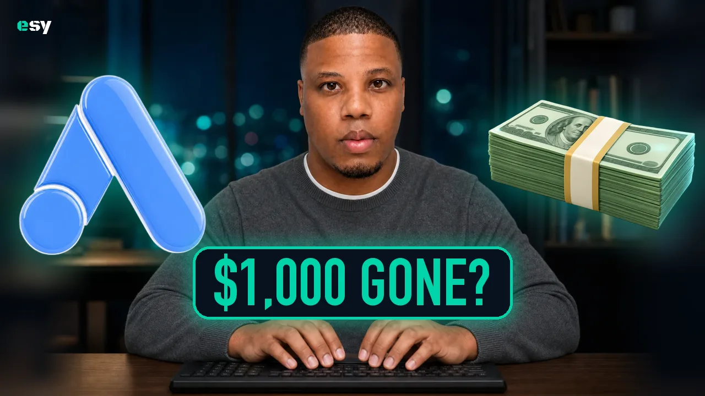
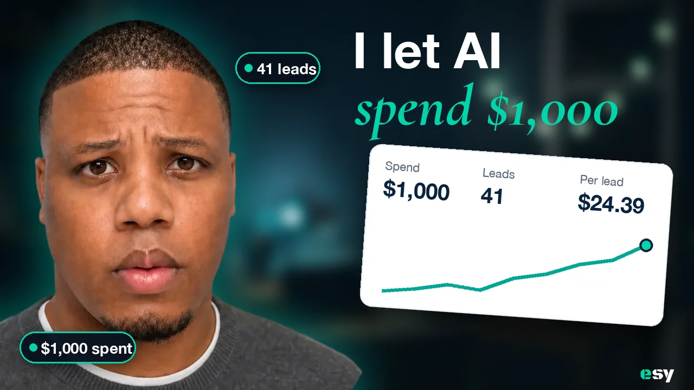
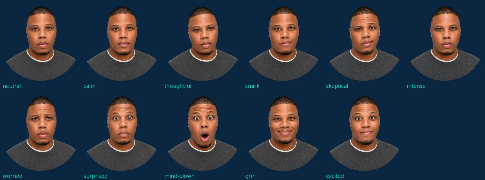

# YouTube: thumbnails

> Also kept in org.esy at `brand/YOUTUBE_THUMBNAILS.md`. Keep the two in step.

Every Esy video gets one of two thumbnails. Both happen in the same place, a dark
navy room with small teal lights behind Zev, so the channel reads as one look
from a distance. Picked 2026-10-11 after four rounds of tries (abstract glowing
scenes, five colour themes, a graph-paper grid, then these).

| Template | For | What's in it |
| --- | --- | --- |
| **A · Desk** | News and launches | Zev centred at his desk, hands on the keyboard. The tool's real logo as a big 3D object on each side (or a prop). A pill label over his chest: 2–3 words in caps, one of them jade. |
| **B · Room** | Tutorials | Zev's face large on the left. A bold line and a jade italic line. The video's real result as a card, tilted like a screen held up to the camera, with two stat pills around his face. |

## The rules

- **Colours.** Navy `#0A2540`, teal `#00A896`, jade `#00D4AA`, white. A tool's
  own colours appear only on its logo.
- **Type.** Desk labels: DIN Condensed Bold, caps. Room headlines: Helvetica
  Neue Bold for the first line, Cormorant Garamond italic (the site's display
  serif) in jade for the second. The esy wordmark (Black Ops One, jade `e`) in a
  corner.
- **Hook.** 2–4 words on the thumbnail; the video title carries the detail. The
  thumbnail sells the feeling, the title says what the video is.
- **Faces come from the face set.** Never generate a new face for one
  thumbnail.
- **Mouth closed, no teeth.** The image model has never seen Zev's teeth, so
  open smiles drift from his likeness.
- **Real numbers only.** Proof cards and stat pills show the video's actual
  results. The examples above use placeholder numbers.
- **Real logos only.** A tool's logo is its own file (from the company or
  Simple Icons), rendered in 3D from that file. Never ask a model to draw a
  logo from memory.
- **Nothing mystical.** No glowing particles, holograms or abstract light
  scenes. That reads as 2023 AI art.

## The face set

Eleven cutouts of Zev in the charcoal sweater over a white T-shirt, background
removed. `neutral` is his real photo, face untouched; the others are expression
edits (the face is redrawn), all with the mouth closed except `mind-blown`.

| Face | Esy run | File |
| --- | --- | --- |
| neutral | run-b25e489f | https://images.esy.com/artifacts/tool/run-b25e489f/step-1.webp |
| calm | run-1e03e351 | https://images.esy.com/artifacts/tool/run-1e03e351/step-1.webp |
| thoughtful | run-187bd1af | https://images.esy.com/artifacts/tool/run-187bd1af/step-1.webp |
| smirk | run-9219b54f | https://images.esy.com/artifacts/tool/run-9219b54f/step-1.webp |
| skeptical | run-0f6c942a | https://images.esy.com/artifacts/tool/run-0f6c942a/step-1.webp |
| intense | run-c94fad6c | https://images.esy.com/artifacts/tool/run-c94fad6c/step-1.webp |
| worried | run-7db1debd | https://images.esy.com/artifacts/tool/run-7db1debd/step-1.webp |
| surprised | run-6396d528 | https://images.esy.com/artifacts/tool/run-6396d528/step-1.webp |
| mind-blown | run-4ee14da7 | https://images.esy.com/artifacts/tool/run-4ee14da7/step-1.webp |
| grin | run-1aca56bd | https://images.esy.com/artifacts/tool/run-1aca56bd/step-1.webp |
| excited | run-03c0b13a | https://images.esy.com/artifacts/tool/run-03c0b13a/step-1.webp |

## Backdrops

| Asset | Esy run | File |
| --- | --- | --- |
| Desk shot (Zev at his desk) | run-cbbc3dd5 | https://images.esy.com/artifacts/tool/run-cbbc3dd5/step-1.webp |
| Room (empty, for B) | run-dffd36ad | https://images.esy.com/artifacts/photo-image/run-dffd36ad/image.webp |

The desk shot is generated from Zev's headshot. **Replace it with a real photo**:
Zev in the sweater, facing the camera, centred, hands on the keyboard, a dark
room with a few small lights behind him, framed with room above his head.

## 3D logos and props

Each was rendered in 3D from the tool's real logo file (`edit-image`), then cut
out (`remove-image-background`). The OpenAI and ElevenLabs marks are black, so
templates draw them inverted to light silver on the dark room.

| Asset | Esy run | Asset | Esy run |
| --- | --- | --- | --- |
| Canva | run-022b4d3e | Meta | run-716933b3 |
| Claude | run-db170350 | n8n | run-81bbccd0 |
| Clay | run-6c5fd4e9 | OpenAI | run-3578eac4 |
| ElevenLabs | run-ad4d9a13 | Perplexity | run-393f375a |
| Gemini | run-39f4bde9 | Zapier | run-cb359a3d |
| Google Ads | run-8270fd64 | prop: browser | run-cf345128 |
| HeyGen | run-317a11bc | prop: calendar | run-e5e1464c |
| Make | run-73cd6469 | prop: ad cards | run-9f125e66 |
| prop: cash | run-44a2bf15 | prop: clapperboard | run-e736c4a6 |
| prop: envelope | run-a49c6447 | | |

Every file is at `https://images.esy.com/artifacts/tool/<run>/step-1.webp`.

## Making a new one

1. **Pick the template.** News or a launch: Desk. A tutorial: Room.
2. **Write the hook.** Desk: 2–3 caps words, one jade. Room: a short bold line
   and a jade italic line.
3. **Pick a face** (Room) whose feeling matches the hook.
4. **New tool?** Get its real logo file, render it in 3D on api.esy.com
   (`edit-image`: "re-render this exact logo as a single glossy 3D object… do not
   change the design"), then `remove-image-background`. About $0.21. Add it to
   the table above.
5. **Room only: the proof.** Use the video's real result: a stats card, an
   answer citing the site, the winning ads, the flow. Two stat pills.
6. **Check it small.** Look at it at search size (about 170px wide) and sidebar
   size (120px). If the hook or the face doesn't read, cut words.

The working scripts (`assets.mjs` renders logos and props, `compose.py` and
`compose2.py` build both templates) live with Zev's experiments, outside the
repo, in `~/Desktop/Esy experiments/yt-thumbnail-templates/parts/`. The Desk and Room code is in `compose.py` (`desk`) and `compose2.py`
(`room`).

## What we tried and dropped

- **Abstract glowing scenes** (data tables of light, holograms): too mystical,
  "AI like 2023".
- **Five colour themes** (terracotta, violet, light themes): one channel needs
  one look; the dark navy ones stood out most in a feed.
- **Graph-paper grid** (after Kallaway): read as generic.
- **Paper and Split** versions of B: Paper is a third look next to Desk; Split's
  jade panel is a different world from the room. Room shares Desk's.
